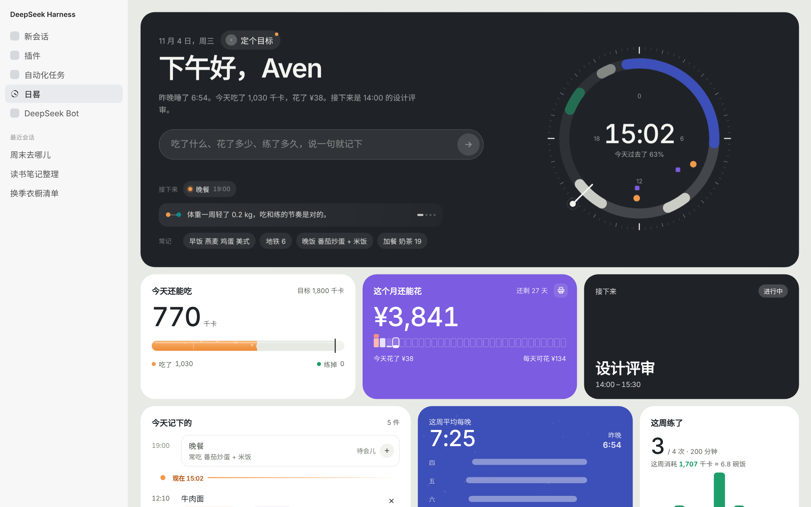
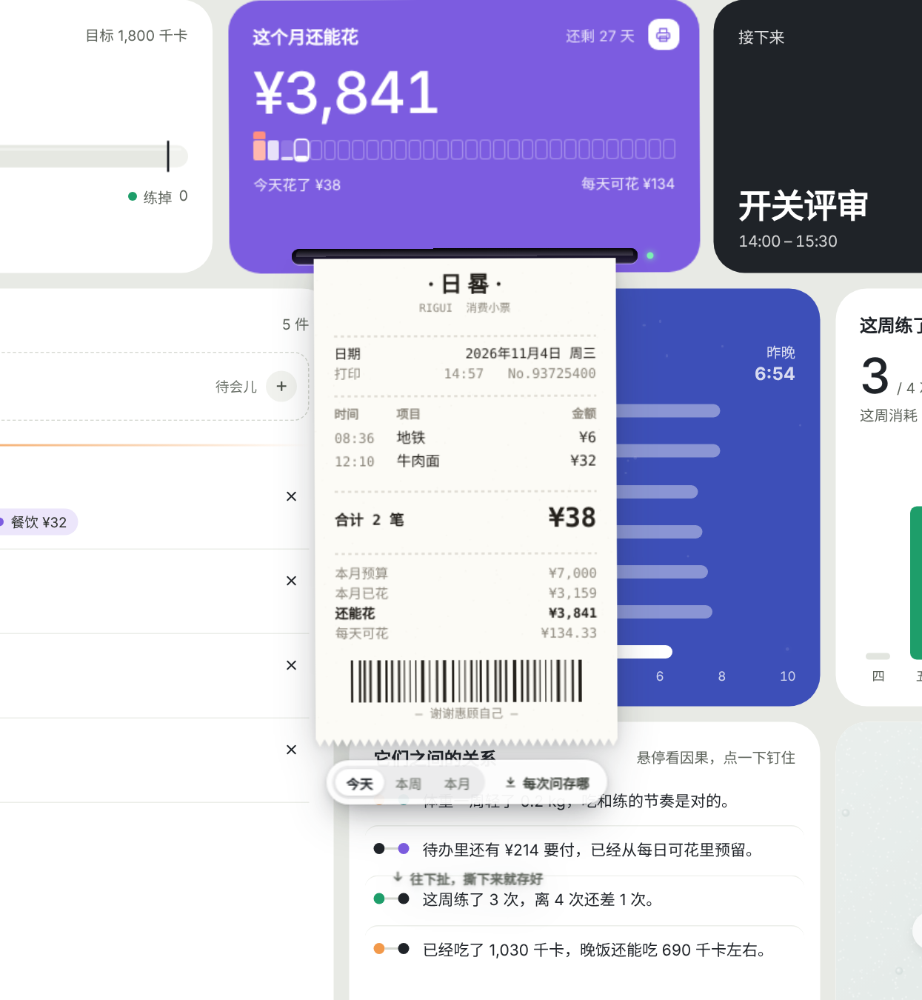
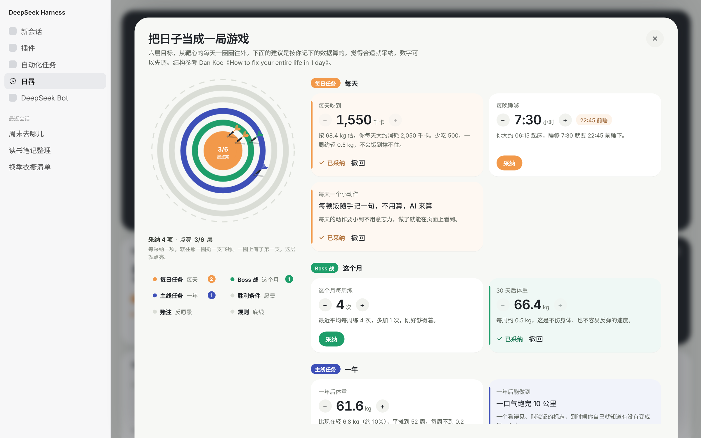

# dsh-rigui · 日晷

给 DeepSeek Harness 的个人生活工作台。睡眠、饮食、运动、花销、体重、日程和待办放在同一页卡片上，而且彼此联动：说一句「早饭 两个麻团 一杯豆浆 8」，热量、花销、今天的时间线会一起动起来。

装好后，左侧边栏多出一行「日晷」，点开就是工作台。点一下问候语可以告诉它怎么称呼你；在主卡片右上角输入城市，就能看到当地天气。



## 安装

```sh
dsh plugin --profile web add github:AvenYQ/dsh-rigui
```

桌面客户端把 `web` 换成你在用的 profile（例如 `desktop`）。装好后重启一次 DSH。

## 说一句就记下

顶部输入框随口说，AI（用你在 DSH 里选的默认模型，优先同家的快速模型）会拆成结构化记录：

- 吃了什么：每样食物单独估热量，数字不对可以直接改，下次会记住
- 花了多少、收入多少
- 练了什么、多久、多少步
- 几点睡、几点起，体重
- 以后要做的事（日程）和没有具体时间的事（待办）
- 「一周前体重 83.2」「上周三跑了 5 公里」这类说法会记到那一天

AI 不可用时有本地规则兜底。

## 主卡片：天气和日程

- 主卡片接实时天气（Open-Meteo，不用 key），像 iOS 天气小组件那样是一块会动的天空：晴天有太阳和光线，阴天飘云，下雨有雨丝，下雪有雪花，夜里是星星和月牙，日出日落前后泛暖光
- 右上角只留城市、现在的温度和今天的高低温；点这三处任意一处，整张主卡片翻到背面：左边是现在的天气，右边是像 iOS 天气小组件那样一天一列的 7 天预报（降水概率、温度区间条），点页面任何地方翻回来；背面点城市名可以换城市
- 正在开会、学习、运动的时候，整张卡慢慢换成这段日程的颜色，右上角显示还剩多久
- 天气也会进「它们之间的关系」：要下雨时提醒户外运动、太热补水、太冷保暖
- 左边只留一个入口：输入框。点进去才浮出该记的事和常记的话，平时是一句今日小结和一条关系提示；右边的靶子是「目标」

## 卡片之间是连着的

- 记一笔，一道道光从输入框连到受影响的卡片，卡片依次闪一下
- 练得越多，「今天还能吃」越多；勾掉带金额的待办，自动记一笔账
- 「它们之间的关系」把睡眠、吃饭、运动、花钱之间的因果找出来，鼠标停上去，一条带彗星的弧线精确连到两张卡里对应的数字

## 动效

每张卡都有自己的手感，不是一套动效套所有卡片。

- **卡片**像挂在线上的工牌：鼠标扫过会被托起、荡一下，同一排的邻居跟着晃；能拖动、能像桌面小组件一样改大小
- **今天还能吃**是一管橙色汽水，在管子上滑动就是「试吃」：液面追着鼠标流过去，冒气泡，超过上限的那段变红
- **这个月还能花**每天一只小钱罐，装了多少就是花了多少；鼠标靠近像点阵一样鼓起来
- **小票打印机**：卡片底边裂开出纸口，热敏小票一格一格吐出来；往下扯，沿着出纸口撕断，同时存成图片（可选每次问、固定文件夹或「下载」）
- **睡眠**卡里藏着一片星星，鼠标像一盏小灯照亮附近的；**运动**柱子像琴键，划过哪天哪根就跳
- **翻面**：点一下卡片，背面写着这个数字是怎么算出来的
- **要做的事**：勾掉的事飘到已完成里；删除时字碎成屑飞走，原地留 4 秒倒计时撤销；清掉的事收在背面，可以放回去
- **体重**蒙着一层雾玻璃，来回擦几下才看得见，走开一会儿又起雾
- 全部做完有一段按顺序走的庆祝；系统设置了减少动态效果时，动效会收敛



## 目标

输入框右边的靶子按钮打开「目标」：按你记下的数据给出六层建议（每日任务、这个月、一年、愿景、反愿景、底线），结构参考 Dan Koe《How to fix your entire life in 1 day》。采纳一项，就往靶子对应那一圈扔一支飞镖；六层都点亮，靶子转一圈锁定。采纳的数字会回到工作台，比如每天的热量目标、每月预算。



## 夜间模式

跟随 DSH 的深色主题自动切换：背景、白卡片、文字、雾玻璃、汽水管和「目标」页都有深色版本，彩色卡片保持原色。

## 数据

所有记录都存在本机浏览器存储里，不上传到任何地方。只有你说的那句话会发给你在 DSH 里配置的模型来解析；查天气时只把城市名和经纬度发给 Open-Meteo。

## 开发

```sh
npm install
npm run build   # 生成 client.js、index.js 和 dist/preview.html
```

- `src/host.js`：主机半边，注册 `/api/rigui` 路由，调用 DSH 的模型解析一句话
- `src/plugin.jsx`：浏览器半边，注册侧边栏入口和主区域页面
- `dist/preview.html`：不依赖 DSH 的预览页，直接用浏览器打开

## License

MIT
